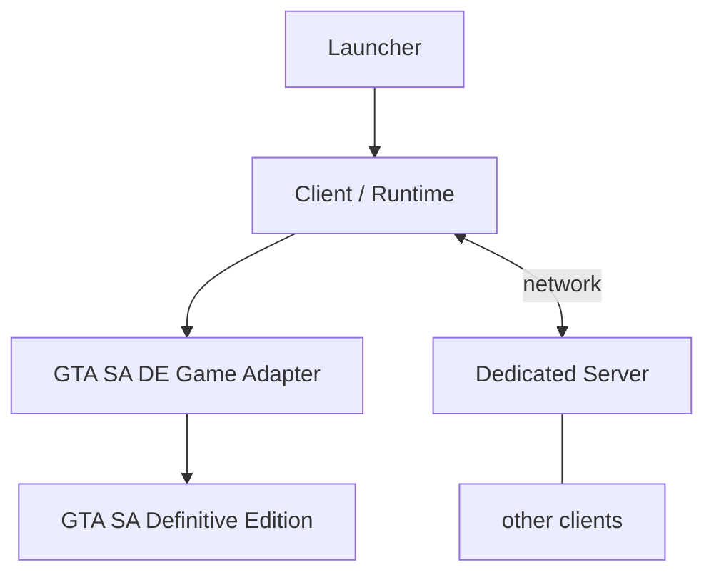

# DE:Flux

Experimental multiplayer framework research for Grand Theft Auto: San Andreas – The Definitive Edition.

> [!IMPORTANT]
> **DE:Flux is discontinued and archived.**
>
> This repository preserves the source code, architecture, and research produced during development.
> It is not a playable multiplayer release, and no GTA SA Definitive Edition build is officially supported.

## What was DE:Flux?

DE:Flux was originally envisioned as a general multiplayer platform for Grand Theft Auto: San Andreas – The Definitive Edition, in the broad category of community multiplayer platforms such as SA-MP, MTA, and FiveM. The project never reached that level of functionality.

The intended split was:

- Launcher
- Client / runtime
- GTA SA DE game adapter
- Dedicated server
- Shared protocol
- Test client
- Research tooling

GTA-specific integration was meant to stay behind the game adapter, so engine details would not leak into the multiplayer core. That separation exists in the source. The live game integration required to use it as multiplayer was not established.

## Architecture

This is the intended shape, not a completed multiplayer implementation.



```text
Launcher
   |
   v
Client / Runtime
   |
   v
GTA SA DE Game Adapter
   |
   v
GTA SA Definitive Edition

Client <---- network ----> Dedicated Server
                              |
                              +---- other clients
```

## Repository components

| Component | Purpose | Final state |
| --- | --- | --- |
| `foundation/` | Version, session, lifecycle, and the game-adapter contract. No GTA types. | Implemented infrastructure. Offline tested. |
| `shared/` | Protocol and player-state types. | Implemented infrastructure. |
| `runtime/` | In-process runtime DLL and C ABI. | Prototype. Offline tested in its own process. |
| `game_adapters/gta_sa_de/` | Install detection, SHA-256 fingerprint, qualification reads, and research scans. | Research-only. Unsupported. |
| `research_launcher/` | Console host for the adapter research entry points. | Research-only. |
| `server/` | UDP server prototype and an in-memory player registry. | Prototype. Incomplete. |
| `launcher/` | Native launcher, optional Node UI, and a `version.dll` proxy. | Prototype. |
| `test_client/` | Headless console client for detection and protocol experiments. | Prototype. Not a player client. |
| `tests/` | Foundation tests, runtime harness, and a research-loader fixture. | Offline tested. |
| `docs/` | Architecture notes and the research record. | Research record. |

## Final technical state

| Capability | Final state |
| --- | --- |
| Game detection | Implemented |
| Build fingerprinting | Implemented |
| Supported GTA SA DE builds | None |
| Compatibility | `DETECTED_BUT_UNSUPPORTED` |
| Production readiness | `NOT_IMPLEMENTED` |
| Qualified GWorld | None |
| Local-player identity | NOT ESTABLISHED |
| Local-player transform | NOT ESTABLISHED |
| Remote-player representation | NOT IMPLEMENTED / NOT PROVEN |
| Playable multiplayer | NO |

See [STATUS.md](STATUS.md).

## What worked

The project did establish:

- a foundation and adapter boundary
- process and executable detection
- SHA-256 fingerprinting of the studied executable
- an explicit unsupported compatibility state, with an empty supported-build list
- research gates that keep synthetic tests off a real game process
- offline and synthetic test infrastructure
- a runtime C ABI checked by a same-process harness
- experimental research tooling for discovery and controlled live studies

The final local check of this archive was:

| Check | Result |
| --- | --- |
| `build.cmd Debug M1` | PASS |
| `build.cmd Debug legacy` | PASS |
| Foundation tests | 1421 passed, 0 failed |
| Runtime harness | 120 passed, 0 failed |

Those are offline infrastructure tests. They are not proof of GTA multiplayer integration.

## Research

The adapter investigated runtime discovery, GWorld qualification, local-player identity, transform discovery, legacy pointer chains, controlled research DLL loading, and behavioral and grounded transform experiments.

The results, including the methods that failed, are in [docs/NEGATIVE_RESULTS.md](docs/NEGATIVE_RESULTS.md). Questions left open are in [docs/OPEN_QUESTIONS.md](docs/OPEN_QUESTIONS.md). Engineering notes are in [POSTMORTEM.md](POSTMORTEM.md).

Negative results are kept so a closed method on the studied build is not mistaken for an open one. A negative result means DE:Flux did not establish that target with the documented method. It does not mean the target cannot exist.

DE:Flux never established a qualified, reproducible path from the studied GTA SA DE build to a local-player identity and transform that could support production multiplayer synchronization. That is the central research conclusion. It is not a claim that the integration is impossible.

## Experimental process interaction

Later research code can inspect a process and load a research DLL. That path uses Windows process-memory APIs: remote allocation, a write of the DLL path, and a remote thread that calls `LoadLibraryW`. Early passive detection did not do this.

These are research mechanisms. They are not production multiplayer support, and they did not change the unsupported compatibility state or the empty supported-build list.

## Legacy prototype

Earlier DE:Flux work included an injected client that tried UE4 pointer chains, position writes, teleport experiments, and early UDP networking. That `client/` tree is not in this archive. Historical documents still name it. Those experiments were not accepted as proof of local-player identity or transform for the later architecture.

## Building

From this directory, with the Visual Studio C++ x64 toolset:

```text
build.cmd Debug M1
build.cmd Debug legacy
```

`Debug M1` builds the foundation, adapter, tests, runtime, harness, test client, research launcher, and loader fixture. `Debug legacy` builds the server, launcher, and version proxy that remain in `DeFlux.sln`.

Verified on this archive: M1 build PASS, legacy build PASS, foundation tests 1421/1421, runtime harness 120/120. Neither command launches GTA. A successful build does not mean the research components work with a current game install.

Slot 8 clean-save deployment is unavailable. The game-derived save template is not part of this archive. The optional launcher UI names the `ws` npm package, which is not vendored here.

More detail is in [docs/development/build.md](docs/development/build.md).

## Why development ended

Development stopped after the research phase. The live integration required for the intended platform was still unproven, and the product, maintenance, and public-release questions were unresolved.

Stopping is not evidence that multiplayer on GTA SA Definitive Edition is technically impossible.

## Why publish the archive?

The repository is public so the architecture stays readable, the research record is not lost, and closed approaches do not have to be repeated from nothing. Other developers can study the tree or fork it. There is no official roadmap and no official support.

## Forking

Forks are welcome under the repository license. A fork is not an official continuation by the original DE:Flux developer. There are no support or compatibility guarantees.

## Repository exclusions

This archive does not include GTA game files or assets, GTA save files, third-party research clones or binaries, raw private research artifacts, or legacy source whose provenance was not established.

## Copyright & License

Copyright © 2026 Mohamed Amin Abouomar.

Original DE:Flux source code and documentation distributed in this repository are licensed under the Apache License, Version 2.0, unless otherwise stated. See [LICENSE](LICENSE) and [NOTICE](NOTICE).

The DE:Flux name, project identity, and original project materials remain attributed to their respective author(s). Forks and derivative works must follow the applicable license terms and must not imply official endorsement or continuation by the original DE:Flux project.

Third-party software and intellectual property remain the property of their respective owners. The `ws` package, if installed for the optional launcher UI, is not included here and keeps its own license.

DE:Flux is not affiliated with Rockstar Games or Take-Two Interactive.

## Disclaimer

DE:Flux is an unofficial community research project. It is not affiliated with, endorsed by, or sponsored by Rockstar Games or Take-Two Interactive.

Grand Theft Auto and related names and trademarks belong to their respective owners.

This notice does not grant permission to modify or redistribute proprietary game content.

> DE:Flux — 2026
>
> Development discontinued. Research preserved.
