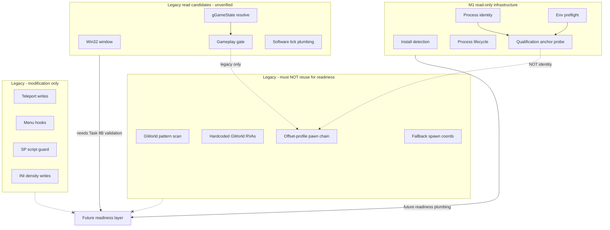

# Runtime Readiness Evidence Audit (Task #8A)

The legacy DeFluxCore client referenced by historical research notes is intentionally excluded from this archival snapshot.

Research and design only. **No readiness implementation.** **No GWorld discovery reopened.**

## Executive conclusion

**No trustworthy runtime-readiness model can be implemented today without a
qualified GWorld pointer or an independently validated alternative identity chain.**

Task #7A–#7B established that **no GWorld-qualified candidate exists** for build
`63e633bb51c35fe35ca98f503b62e7ddb8403abe4c9d501cfa9162892453846f`. Readiness
must not substitute another single “magic pointer.”

What **does** exist:

| Source | Usable for future readiness? |
| --- | --- |
| M1 process observation + qualification infrastructure | **Yes** — as plumbing and safety boundary |
| OS-level process/window lifetime | **Yes** — weak boot signal only |
| Legacy `gGameState` gate | **Validated for FRONTEND vs POST_FRONTEND** (Task #8B live); not readiness |
| Legacy UE4 offset-profile pawn chain | **Not safe to reuse** — unverified, identity-unproven |
| Legacy menu hooks / SP suppression / teleports | **Must not reuse** — modification-only |
| Manual live observation phase labels (Task #7B.1) | **Research metadata only** — not automated detection |

**Implementation of `engine_ready` / `world_ready` / `local_player_ready` is NOT
justified** until Task #8B (or later) produces build-qualified, multi-signal,
externally validated observation evidence through `LOCAL_PLAYER_READY`.

Current platform state unchanged:

| Field | Value |
| --- | --- |
| Supported-build registry | **EMPTY** |
| Compatibility | **DETECTED_BUT_UNSUPPORTED** |
| Readiness | **NOT_IMPLEMENTED** |
| GWorld research | **Closed** — negative result final |

---

## Audited components

### M1 platform

| Component | Primary paths |
| --- | --- |
| Game adapter | `game_adapters/gta_sa_de/src/adapter.cpp`, `detection.cpp`, `observation.cpp`, `qualification.cpp` |
| Process lifecycle | `foundation/include/deflux/core/process_lifecycle.hpp` |
| Session model | `foundation/include/deflux/core/session_state.hpp` |
| Readiness contract | `foundation/include/deflux/game/adapter.hpp` |
| Live research (closed) | `gworld_live_observation.*`, `gworld_structural_identity_probe.*` |
| Tests | `tests/foundation/src/*` |
| Test client | `test_client/src/main.cpp` |
| Docs | `docs/architecture/*.md` |

### Legacy prototype (`client/` — research only, not M1 runtime)

| Component | Primary paths |
| --- | --- |
| Integration hub | `client/src/dllmain.cpp` |
| Local player | `client/src/game/local_player.cpp` |
| UE4 memory / GWorld chain | `client/src/game/ue4_memory.cpp` |
| Gameplay gate | `client/src/ue4/ue4_gameplay_gate.cpp` |
| Menu boot | `client/src/game/sa_interface_boot.cpp`, `menu_new_game.cpp` |
| SP suppression | `client/src/hooks/sp_script_guard.cpp`, `mp_world.cpp` |
| Direct join / spawn | `client/src/game/direct_join.cpp` |
| Hook engine | `client/src/hooks/hook_engine.cpp` |

---

## Evidence inventory

Each mechanism is classified exactly once.

| ID | Mechanism | Path / symbol | Attempted observation | R/W | Build-specific? | Historically validated? | Failure modes | Classification |
| --- | --- | --- | --- | --- | --- | --- | --- | --- |
| E01 | Readiness API stubs | `adapter.cpp` — `engine_ready/world_ready/local_player_ready` | Nothing (constant `NOT_IMPLEMENTED`) | Neither | No | Yes (tests) | N/A | **EVIDENCE_WEAK** (negative evidence: no signal) |
| E02 | Install + fingerprint detection | `detection.cpp` — `detect_installation()` | Exe path, SHA-256, file version, optional PID | Read | Per SHA | Unit tests | Missing install | **EVIDENCE_STRONG** (for install presence) |
| E03 | Process identity observation | `observation.cpp` — `sample_live_process()` | PID, creation FILETIME, verified image path | Read | No | Unit + integration tests | PID reuse, path mismatch | **EVIDENCE_STRONG** (for process lifetime) |
| E04 | Process lifecycle machine | `process_lifecycle.cpp` — `advance_process_lifecycle()` | NOT_RUNNING → DETECTED → EXITED | Pure | No | Unit tests | Observation errors | **EVIDENCE_STRONG** (OS lifecycle) |
| E05 | Environment preflight | `environment_preflight.cpp` | Legacy artifacts beside exe | Read (filesystem) | No | Unit tests | Contamination blocks probe | **EVIDENCE_STRONG** (safety gate) |
| E06 | Runtime qualification | `qualification.cpp` — `qualify_observation()` | GWorld slot @ `0x05391B70`, vtable shape | Read | Yes (profile SHA) | Logic tests; live pass **invalidated** (contamination) | Null at menu; unverified RVA | **EVIDENCE_WEAK** (anchor shape only) |
| E07 | GWorld anchor evaluation | `qualification.cpp` — `evaluate_gworld_anchor()` | Pointer canonicality, module range, vtable in-module | Read (logic) | No | Unit tests | Null/non-canonical/inside-module | **EVIDENCE_PROMISING_UNVERIFIED** (shape rules, not identity) |
| E08 | Manual live phase labels | `gworld_live_observation.cpp` — `parse_live_observation_phase()` | Operator-typed MENU/LOADING/GAMEPLAY_* | Read (stdin) | No | Live sessions (manual) | Not automated; subjective | **EVIDENCE_WEAK** (human labels only) |
| E09 | Live slot observation | `gworld_live_observation.cpp` — `probe_candidate_slot()` | Slot null/non-null, first qword | Read | Yes (approved RVAs) | Two live sessions | No identity proof | **EVIDENCE_WEAK** |
| E10 | Structural identity probe | `gworld_structural_identity_probe.cpp` | 256-byte prefix, module-resident first qword | Read | Yes (`0x05764130`) | One live snapshot | Identity unproven | **EVIDENCE_WEAK** |
| E11 | SessionState enum | `session_state.hpp` | MP lifecycle model (names only) | Model | No | Name tests | No runtime transitions | **EVIDENCE_WEAK** (target taxonomy) |
| E12 | Win32 window detection | `dllmain.cpp` — `game_window_ready()` | `UnrealWindow` class / title match | Read | Partial (title string) | Legacy in-process | Window ≠ gameplay | **EVIDENCE_PROMISING_UNVERIFIED** |
| E13 | Module handle boot wait | `dllmain.cpp` — `wait_for_game_boot()` | `SanAndreas.exe` module / window poll + Sleep | Read + **Sleep delay** | Module names | Legacy only | Timing-based; not evidence | **EVIDENCE_WEAK** |
| E14 | gGameState resolution | `ue4_gameplay_gate.cpp` — `resolve_game_state()` | Script global byte via `"menu_mainpresents"` xref + `cmp …, 9` | Read | Signature heuristic | **Task #8B live validated** (FRONTEND vs POST_FRONTEND) | Value 8 not seen; 9 not phase-specific | **EVIDENCE_PROMISING_UNVERIFIED** (phase signal, not readiness) |
| E15 | Gameplay resolve gate | `ue4_gameplay_gate.cpp` — `gameplay_ready_for_resolve()` | State==9 + 1.5s delay; 8s fallback timer | Read + **Sleep** | Partial | Legacy only | Fallback bypasses real state | **EVIDENCE_PROMISING_UNVERIFIED** |
| E16 | GWorld pattern scan | `ue4_memory.cpp` — `scan_gworld_candidates()` | `.text` RIP-relative mov patterns | Read | Heuristic | **Rejected** in docs | Many false positives | **EVIDENCE_INVALID** |
| E17 | Hardcoded GWorld RVAs | `ue4_memory.cpp` — `kCandidateRvas[]` | Slot @ `0x05391B70`, `0x0FE1D1D8` | Read | Yes | **Unverified / invalid** | Null in gameplay; OOB RVA | **EVIDENCE_INVALID** |
| E18 | String scan GWorld | `ue4_memory.cpp` — `scan_secondary_gworld()` | ASCII `GWorld`, `PersistentLevel`, etc. | Read | Heuristic | **Rejected** | Spurious cells | **EVIDENCE_INVALID** |
| E19 | Offset-profile pawn chain | `ue4_memory.cpp` — `probe_profile()` | GWorld→UWorld→GI→LocalPlayer→PC→Pawn→Root→transform | Read | Yes (9 named profiles) | **Rejected** for qualification | Wrong actor; menu breaks | **EVIDENCE_INVALID** |
| E20 | PersistentLevel actor scan | `ue4_memory.cpp` — `try_persistent_level_pawn()` | First plausible actor in level array | Read | Heuristic grid | Unverified | Random world actor | **EVIDENCE_INVALID** |
| E21 | Auto offset discovery | `ue4_memory.cpp` — `discover_offsets()` | Brute-force offset grids | Read | Search | Unverified | False local player | **EVIDENCE_INVALID** |
| E22 | Local player fallback spawn | `local_player.cpp` — `set_fallback_spawn()` | Hardcoded Grove coords `{2495,-1680,13.5}` | Fake read | Hardcoded | Used when chain fails | **Presents invalid as valid** | **EVIDENCE_INVALID** |
| E23 | Manual position pointers | `local_player.cpp` — `set_position_address()` | Absolute float[3] | Read | Caller | **Never wired** | Dead API | **EVIDENCE_INVALID** |
| E24 | Teleport / memory writes | `ue4_memory.cpp` — `try_write_position()`, `write_vec3()` | Position write via VirtualProtect | **Modify** | Profile-dependent | **Rejected** | Game overwrite / AV | **MODIFICATION_ONLY** |
| E25 | Menu native hook | `sa_interface_boot.cpp` — `install_menu_hook()` | Inline JMP on menu update; calls StartNewGame/Resume | **Modify** | String xrefs | **Rejected** | Crash; timing | **MODIFICATION_ONLY** |
| E26 | Menu poll entry | `sa_interface_boot.cpp` — `SaInterfaceBoot::tick()` | Calls natives when frontend state==7 | **Modify** | gGameState values | Legacy | Requires captured `this*` | **MODIFICATION_ONLY** |
| E27 | Entry mode file | `menu_new_game.cpp` — `read_entry_mode()` | `deflux_entry_mode.txt` beside exe | Read (file) | Launcher contract | Contamination marker | Not game state | **EVIDENCE_WEAK** |
| E28 | SP script guard | `sp_script_guard.cpp` — `SpScriptGuard::tick()` | Script globals via `"mainV1.scm"`, `"GW_ATK"`, etc. | **Modify** | Symbol heuristics | Unverified | Wrong script space | **MODIFICATION_ONLY** |
| E29 | MpWorld INI density | `mp_world.cpp` — `apply_empty_world_settings()` | Writes Rockstar Documents INI keys | **Modify** (filesystem) | Path | Legacy | File modification | **MODIFICATION_ONLY** |
| E30 | Software tick driver | `hook_engine.cpp` — `start_software_tick()` | 25 Hz worker invokes frame callback | Read (timing) | Rate clamp 20–30 Hz | Legacy wired | Not game-phase evidence | **EVIDENCE_PROMISING_UNVERIFIED** (plumbing) |
| E31 | Present hook | `hook_engine.cpp` — `install_present_hook()` | DXGI Present (stub) | Intended hook | N/A | **Unused stub** | Never called | **EVIDENCE_INVALID** |
| E32 | DirectJoin spawn gate | `direct_join.cpp` — `sync_allowed()` | Server spawn applied flag | Protocol | N/A | Network layer | Not game memory proof | **EVIDENCE_WEAK** (protocol gate) |
| E33 | Frontend skip stub | `frontend_skip.cpp` | Empty — FusionFix handles skip | N/A | N/A | Removed | No-op | **EVIDENCE_INVALID** |

**Camera / viewport:** No mechanism found in M1 or legacy `client/` for
`PlayerCameraManager`, view target, or `UGameViewportClient`. **Missing evidence.**

---

## Dependency map



---

## Legacy assumptions that must NOT be reused

1. **Single GWorld slot as readiness proxy** — Task #7B proved no qualified candidate.
2. **Offset-profile pawn walk** (`kProfiles[]` in `ue4_memory.cpp`) — identity-unproven; may read any plausible actor.
3. **PersistentLevel actor scan** — not local player.
4. **Fallback Grove Street coordinates** as valid player state — violates principle #7 (no simulated state as real).
5. **Fixed Sleep delays** (`wait_for_game_boot`, `kPostPlayingDelay`, 8s fallback) as readiness evidence.
6. **Menu hooks / native calls / story-skip paths** — modification-only; not observation.
7. **SP suppression / mission mute / INI density writes** — modification-only.
8. **Memory writes / teleports / VirtualProtect** — modification-only.
9. **Pattern/string GWorld scans** — rejected false-positive sources.
10. **Hardcoded RVAs** `0x05391B70` / `0x0FE1D1D8` — unverified or invalid for current build.
11. **QUALIFIED qualification status** as `world_ready` — explicitly forbidden by architecture.
12. **Manual phase labels** as automated menu/loading detection.

---

## Readiness matrix (through LOCAL_PLAYER_READY)

Future states from architecture (`principles.md`, `session_state.hpp`). Focus
through **LOCAL_PLAYER_READY** only.

| State | Minimum evidence required | Currently available | Missing | Implementable now? |
| --- | --- | --- | --- | --- |
| **GAME_BOOTING** | Verified process exists; main module mapped; PE readable | E02–E05 (install, PID, module via qualification path) | In-process engine init signal | **Partial** — external process/module only |
| **ENGINE_READY** | Gameface/UE module loaded; engine loop active; not merely process alive | E12 window class (legacy, unverified externally); E13 module poll (Sleep-based) | External validated engine tick or init flag | **No** |
| **WORLD_LOADING** | Transition signal: frontend→load, level streaming, non-null world context | E08 manual LOADING label; E06 null GWorld at menu (weak inverse) | Automated loading indicator; validated world-context pointer | **No** |
| **WORLD_READY** | Validated world instance exists; persistent level or equivalent **proven** | E06–E07 anchor shape (unverified slot); E09–E10 live null/non-null patterns | Qualified world identity; multi-signal world proof | **No** |
| **LOCAL_PLAYER_READY** | Local player controller/pawn exists; transform readable and **identity-proven** | E19 chain (invalid for reuse); E22 fallback (invalid) | Controller/pawn identity without magic pointer; external read path | **No** |

States beyond LOCAL_PLAYER_READY (MULTIPLAYER_PREPARE, MULTIPLAYER_READY,
REQUEST_SPAWN, SPAWNED) are **out of scope** for Task #8A.

### Multi-signal requirement (architectural rule)

Future readiness must combine **independent validated signals** where
appropriate, for example:

- process + module validity (already available)
- **plus** a build-qualified script-state or frontend-state signal (E14 candidate)
- **plus** a build-qualified world-context signal (not available — GWorld research closed negative)
- **plus** a build-qualified local-player identity signal (not available)

No single pointer may gate all readiness states.

---

## Strongest currently available evidence

| Rank | Evidence | Contributes to |
| --- | --- | --- |
| 1 | **E03/E04** Process identity + lifecycle | GAME_BOOTING (process alive) |
| 2 | **E02** Install fingerprint + detection | GAME_BOOTING (correct binary) |
| 3 | **E05** Environment preflight | Safety gate before any future probe |
| 4 | **E14** gGameState script global (legacy, in-process) | ENGINE_READY / WORLD_LOADING candidate **if externally validated** |
| 5 | **E12** UnrealWindow presence | Weak ENGINE_BOOTING hint |
| 6 | **E07** Pointer-shape validation rules | Reusable **validation logic**, not readiness by itself |

---

## Missing evidence

| Gap | Why it blocks readiness |
| --- | --- |
| Qualified GWorld / UWorld identity | Task #7 closed negative |
| Automated distinction of loading vs gameplay vs pause via gGameState alone | Task #8B: value 9 in all POST_FRONTEND phases |
| Automated frontend/menu/loading detection | Only manual labels exist |
| Build-qualified UE object identity chain | Offset profiles unverified |
| Local player identity proof | No pawn/controller validation without chain |
| Player transform (read-only, proven) | Chain rejected; fallback invalid |
| Camera / viewport signals | Not implemented anywhere |
| Engine tick / init completion signal | Present hook stub; no external observer |
| Multi-signal correlation framework | Not implemented (stubs only) |

---

## Task #8B — gGameState external observer (complete)

**Status:** Observer implemented, unit-tested, and **one architect-approved live session
completed** on build `63e633bb51c35fe35ca98f503b62e7ddb8403abe4c9d501cfa9162892453846f`.

### Legacy gGameState mechanism (audited)

| Field | Detail |
| --- | --- |
| Primary source | `client/src/ue4/ue4_gameplay_gate.cpp` — `resolve_game_state()` |
| Duplicate logic | `client/src/game/sa_interface_boot.cpp` — `resolve_game_state()` (same algorithm) |
| Symbol | In-process `std::uint8_t* g_game_state` (single global byte) |
| Location method | **Signature / xref heuristic** — not a hardcoded RVA, not GWorld, not UE global table export |
| Step 1 | Scan **non-executable** PE sections for ASCII `"menu_mainpresents"` |
| Step 2 | Scan **executable** sections for RIP-relative LEA (`48/4C 8D … modrm & 0xC7 == 0x05`) xrefs to that string (max 24) |
| Step 3 | For each LEA xref, scan ±`0x800` bytes for `cmp byte ptr [rip+disp32], imm8` where `(b[0]==0x80 \|\| b[0]==0x83) && b[1]==0x3D && b[6]==9` |
| Step 4 | Global RVA = `cmp_instruction_rva + 7 + disp32` |
| Read path | `*g_game_state` — read-only in gate |
| Writes (not ported) | Menu hooks, native calls, position writes in `sa_interface_boot.cpp` / `ue4_memory.cpp` |

### Historical values 7 / 8 / 9

Defined only in `sa_interface_boot.cpp` comments and usage:

| Value | Legacy name | Legacy usage |
| --- | --- | --- |
| 7 | `kGsFrontend` | Menu boot entry fires when state == 7 |
| 8 | `kGsInitPlayingGame` | Named transition state (comment only in gate path) |
| 9 | `kGsPlayingGame` | Gate waits for state == 9 before pawn resolve; also the **only** immediate used in the cmp search pattern |

**Proven vs assumed:** Only the **existence of a cmp-against-9** near
`menu_mainpresents` xrefs is code-evidenced. The semantic mapping of 7/8/9 to
frontend/init/playing was **assumed** by legacy authors and **not demonstrated**
on vanilla external observation.

### M1 port (observation only)

| Component | Path |
| --- | --- |
| Header | `game_adapters/gta_sa_de/include/deflux/game/gta_sa_de/ggame_state_observation.hpp` |
| Implementation | `game_adapters/gta_sa_de/src/ggame_state_observation.cpp` |
| Tests | `tests/foundation/src/qualification_ggame_state_observation_tests.cpp` |
| CLI (future live) | `test_client --ggame-state-observe-live` |

**Derivation method enum:** `MENU_MAINPRESENTS_LEA_CMP_IMM9`

**Justification for build `63e633bb…`:** The algorithm is deterministic, bounded,
and identical in two legacy files. It operates on a one-time flat module image read
via `ReadProcessMemory` (full `SizeOfImage`), then samples the resolved global with
1-byte reads. This is a **direct port of legacy evidence**, not a new scan or guessed
RVA. If the anchor string or cmp pattern is absent in the mapped image, the session
returns `GAMESTATE_INSUFFICIENT` and **does not invent** a replacement address.

**Not ported:** `gameplay_ready_for_resolve()` Sleep delays, menu hooks, SP
suppression, pawn/GWorld traversal, offset profiles, any write/inject/hook path.

### Process rights and memory access

| Allowed | Forbidden |
| --- | --- |
| `PROCESS_QUERY_LIMITED_INFORMATION` | `PROCESS_VM_WRITE`, `PROCESS_VM_OPERATION` |
| `PROCESS_VM_READ` | injection, DLL load, hooks, remote threads, patching, `VirtualProtect` |
| `ReadProcessMemory` only | GTA/Rockstar file modification, story skip, teleport, save manipulation |

Reuses M1: verified `ProcessObservation`, PID + creation-time identity, executable
path verification, exact SHA-256 gate, ASLR module resolution, PE validation,
environment preflight, identity re-check before/after samples, clean handle close.

### Experiment design (live — not yet executed)

1. Operator launches vanilla GTA manually (tool never launches the game).
2. `DeFlux_TestClient.exe --ggame-state-observe-live [--interval-ms N] [--max-samples N]`
3. Operator enters manual phase labels: `MENU`, `LOADING`, `GAMEPLAY_STANDING`,
   `GAMEPLAY_MOVING`, `PAUSE_MENU`, or `STOP`.
4. Default interval **500 ms**; max **120** sample batches.
5. Each sample records: index, manual phase, derivation method, resolved address,
   read success/failure, raw byte, timestamp, process identity validity.
6. Research classification only: `GAMESTATE_OBSERVED`, `GAMESTATE_INSUFFICIENT`,
   `GAMESTATE_CONTRADICTED` — never `ENGINE_READY` / `WORLD_READY` /
   `LOCAL_PLAYER_READY`.
7. Labels are metadata only; observer must not infer readiness from them.

### Live session results (architect-approved)

| Field | Value |
| --- | --- |
| status | **OK** |
| classification | **GAMESTATE_OBSERVED** |
| derivation | **MENU_MAINPRESENTS_LEA_CMP_IMM9** |
| resolved | **yes** |
| global_rva | **0x05300FF8** |
| cmp_rva | **0x011BE33A** |
| anchor_rva | **0x0430F418** |
| successful reads | **5 / 5** |
| process identity | **valid for all samples** |
| resolved VA | **same for all samples** (ASLR base + global_rva) |

**Per-phase observations (one sample each; manual labels):**

| Manual phase | Raw value |
| --- | --- |
| MENU | **7** |
| LOADING | **9** |
| GAMEPLAY_STANDING | **9** |
| GAMEPLAY_MOVING | **9** |
| PAUSE_MENU | **9** |

**Architect conclusions (recorded):**

- The signal distinguishes **FRONTEND (7)** from **POST_FRONTEND (9)** in this session.
- Value **8 was NOT observed** (legacy `kGsInitPlayingGame` remains unverified).
- Value **9 cannot distinguish** loading, gameplay standing, gameplay moving, or pause menu
  from this run (all POST_FRONTEND phases read 9).
- Only **one sample per phase**; manual phase timing is subjective.
- The signal **may contribute** to future **multi-signal** readiness.
- The signal **cannot independently establish** `WORLD_READY` or `LOCAL_PLAYER_READY`.
- **Do not claim** that 9 means `WORLD_READY`.
- **Do not hardcode** `0x05300FF8` into production readiness — address remains derived
  from the bounded legacy heuristic per session.

**Platform state unchanged:** supported registry **EMPTY**, compatibility
**DETECTED_BUT_UNSUPPORTED**, readiness **NOT_IMPLEMENTED**.

---

## Task #8C — Local player evidence audit (complete)

**Status:** Source/offline audit only. **GTA remained closed.** No new live access.
No local-player candidate promoted. GWorld research **not reopened**.

### Primary question

> What existing evidence can justify a bounded future experiment for identifying the
> real local gameplay player without guessing offsets and without reopening GWorld discovery?

**Answer:** Only **weak, GWorld-dependent** legacy chains exist. No non-GWorld local-player
identity path is documented or validated. A justified **identity-qualified** local player
candidate **does not currently exist**. Task #8D proposes a **falsification-oriented**
chain-break diagnostic — not identity promotion.

### Identity vs availability vs transform (kept separate)

| Question | Current evidence |
| --- | --- |
| **A. Player identity** — is this object the local gameplay player? | **None validated.** Legacy chains assume GWorld→…→Pawn but never prove identity. |
| **B. Player availability** — does a valid local player exist now? | **Weak.** gGameState 9 implies POST_FRONTEND only; legacy gate **assumes** PC/Pawn exist after settle — **not demonstrated** externally. |
| **C. Player transform** — position/rotation readable? | **Invalid for reuse.** Transform reads depend on rejected GWorld chain or actor scan; `plausible_world_pos()` is **not identity**. |

### Local player evidence inventory

Each mechanism classified exactly once. Scope: legacy `client/` + M1 stubs.

| ID | Mechanism | File / symbol | Purpose | Dependency chain | Address source | Depth | R/W | Exercised? | GWorld dep? | Task #7 dep? | Classification |
| --- | --- | --- | --- | --- | --- | --- | --- | --- | --- | --- | --- |
| LP01 | Local player sample orchestrator | `local_player.cpp` — `LocalPlayerReader::sample()` | Produce transform for PLAYER_SYNC | Manual ptr → UE4 resolver → fallback spawn | Mixed | 0–7 | Read | Yes (legacy) | **Yes** (via resolver) | Indirect | **LOCAL_PLAYER_EVIDENCE_WEAK** |
| LP02 | Manual position pointers | `local_player.cpp` — `set_position_address()` | Absolute float[3] read | None | Caller-supplied | 0 | Read | **Never wired** | No | No | **LOCAL_PLAYER_EVIDENCE_INVALID** |
| LP03 | Manual heading pointer | `local_player.cpp` — `set_heading_address()` | Absolute float read | None | Caller-supplied | 0 | Read | **Never wired** | No | No | **LOCAL_PLAYER_EVIDENCE_INVALID** |
| LP04 | Fallback spawn coords | `local_player.cpp` — `set_fallback_spawn()` | Fake valid transform when chain fails | None | Hardcoded / server spawn | 0 | Fake read | Yes | No | No | **LOCAL_PLAYER_EVIDENCE_INVALID** |
| LP05 | UE4 resolver entry | `ue4_memory.cpp` — `Ue4LocalPlayerResolver::resolve()` | Gate + scan + match profiles | gGameState gate → GWorld slot → profile chain | Scan + hardcoded RVAs | 7 | Read | Yes | **Yes** | Uses `0x05391B70` | **LOCAL_PLAYER_EVIDENCE_INVALID** |
| LP06 | GWorld .text pattern scan | `ue4_memory.cpp` — `scan_gworld_candidates()` | Find RIP-relative GWorld mov patterns | Pattern → slot → deref test | 5 byte patterns | 1 | Read | Yes | **Yes** | No | **LOCAL_PLAYER_EVIDENCE_INVALID** |
| LP07 | Hardcoded GWorld RVAs | `ue4_memory.cpp` — `kCandidateRvas[]` | Seed slots `0x05391B70`, `0x0FE1D1D8` | Slot → world ptr | Hardcoded RVA | 1 | Read | Yes | **Yes** | **0x05391B70** approved for **observation only** | **LOCAL_PLAYER_EVIDENCE_INVALID** |
| LP08 | String secondary GWorld scan | `ue4_memory.cpp` — `scan_secondary_gworld()` | `"GWorld"`, `"PersistentLevel"`, `"OwningGameInstance"` | String → nearby pointer cells | ASCII search + ±0x40 cell probe | 1 | Read | Yes | **Yes** | No | **LOCAL_PLAYER_EVIDENCE_INVALID** |
| LP09 | Offset-profile pawn chain | `ue4_memory.cpp` — `probe_profile()` + `kProfiles[]` | GWorld→UWorld→GI→LocalPlayers→LP→PC→Pawn→Root→transform | Full UE chain | Named offset grids (9 profiles) | 7 | Read | Yes | **Yes** | Requires non-null slot | **LOCAL_PLAYER_EVIDENCE_INVALID** |
| LP10 | Auto offset discovery | `ue4_memory.cpp` — `discover_offsets()` | Brute-force GI/LP/PC/Pawn/Root/Xform grids | Same as LP09 | Search grids | 7 | Read | Yes | **Yes** | No | **LOCAL_PLAYER_EVIDENCE_INVALID** |
| LP11 | PersistentLevel actor scan | `ue4_memory.cpp` — `try_persistent_level_pawn()` | First actor with plausible transform | GWorld→Level→Actors[]→Root | Offset grids | 4 | Read | Yes | **Yes** | No | **LOCAL_PLAYER_EVIDENCE_INVALID** |
| LP12 | Transform plausibility filter | `ue4_memory.cpp` — `plausible_world_pos()` | Reject non-finite / out-of-map coords | Applied to any candidate translation | N/A | 0 | Validate | Yes | No | No | **LOCAL_PLAYER_EVIDENCE_WEAK** (filter only, **not identity**) |
| LP13 | ComponentToWorld read | `ue4_memory.cpp` — `try_read_world_pos()` | FTransform @ RootComponent | Pawn→Root→Xform | Profile offset | 2 | Read | Yes | **Yes** | No | **LOCAL_PLAYER_EVIDENCE_PROMISING_UNVERIFIED** (shape only) |
| LP14 | RelativeLocation fallback reads | `ue4_memory.cpp` — `read_any_root_transform()` | Alternate root offsets `{0x11C,0x128,…}` | Pawn→Root | Hardcoded grid | 2 | Read | Yes | **Yes** | No | **LOCAL_PLAYER_EVIDENCE_INVALID** |
| LP15 | Position teleport write | `ue4_memory.cpp` — `try_write_position()` | Write vec3 to root + offsets | Same chain as LP09 | Resolved root | 2 | **Modify** | Yes | **Yes** | No | **MODIFICATION_ONLY** |
| LP16 | Gameplay resolve gate | `ue4_gameplay_gate.cpp` — `gameplay_ready_for_resolve()` | Wait gGameState==9 + 1.5s | gGameState only | Signature (E14) | 0 | Read + Sleep | Yes | No | No | **LOCAL_PLAYER_EVIDENCE_PROMISING_UNVERIFIED** (availability hint, not identity) |
| LP17 | gGameState external observer | `ggame_state_observation.*` (M1) | FRONTEND vs POST_FRONTEND | E14 derivation | Legacy heuristic | 0 | Read | **Task #8B live** | No | No | **LOCAL_PLAYER_EVIDENCE_WEAK** (phase gate only) |
| LP18 | DirectJoin spawn sync | `direct_join.cpp` — `try_apply_spawn()` | Server spawn → fallback + teleport | Network → LocalPlayerReader | Protocol | 0 | Mixed | Yes | Indirect | No | **LOCAL_PLAYER_EVIDENCE_WEAK** (protocol gate, not game identity) |
| LP19 | Grove Street constants | `mp_world.hpp` — `kGroveSpawn*` | Default spawn location | None | Hardcoded coords | 0 | N/A | Legacy | No | No | **LOCAL_PLAYER_EVIDENCE_INVALID** |
| LP20 | SA boot gGameState poll | `sa_interface_boot.cpp` — `tick()` | Menu entry when state==7 | gGameState | E14 | 0 | Read + **native calls** | Yes | No | No | **MODIFICATION_ONLY** |
| LP21 | PLAYER_SYNC frame tick | `dllmain.cpp` — `on_frame_tick()` | 25 Hz sync after spawn gate | DirectJoin → sample() | N/A | 0 | Read | Yes | **Yes** | No | **LOCAL_PLAYER_EVIDENCE_WEAK** |
| LP22 | Readiness API stubs | `adapter.cpp` — `local_player_ready()` | Platform contract | None | N/A | 0 | Neither | Tests | No | No | **LOCAL_PLAYER_EVIDENCE_WEAK** (negative) |

**Camera / viewport / PlayerCameraManager:** No legacy mechanism found. **Missing evidence.**

### Legacy `kProfiles[]` audit

All profiles in `ue4_memory.cpp` — **none registered, none reused.**

| Profile | owning_game_instance | local_players | player_controller | pawn | root_component | component_to_world | Build assumption | Root dep | Validated? |
| --- | --- | --- | --- | --- | --- | --- | --- | --- | --- |
| ue4.26-a | 0x180 | 0x38 | 0x30 | 0x2A0 | 0x130 | 0x1C0 | Generic UE4.26 | **GWorld slot** | **No** |
| ue4.26-b | 0x188 | 0x38 | 0x30 | 0x2A8 | 0x138 | 0x1C0 | Generic UE4.26 | **GWorld slot** | **No** |
| ue4.26-c | 0x1A0 | 0x40 | 0x38 | 0x2B0 | 0x190 | 0x1C0 | Generic UE4.26 | **GWorld slot** | **No** |
| sade-ish | 0x1F8 | 0x40 | 0x38 | 0x2A0 | 0x130 | 0x1C0 | SA DE guess | **GWorld slot** | **No** |
| sade-b | 0x1F8 | 0x40 | 0x38 | 0x430 | 0x220 | 0x230 | SA DE guess | **GWorld slot** | **No** |
| ue4.27 | 0x1C0 | 0x40 | 0x30 | 0x2A0 | 0x168 | 0x1C0 | Generic UE4.27 | **GWorld slot** | **No** |
| wide-a | 0x1F8 | 0x38 | 0x30 | 0x2A0 | 0x130 | 0x1C0 | Grid variant | **GWorld slot** | **No** |
| wide-b | 0x180 | 0x40 | 0x38 | 0x2A0 | 0x138 | 0x1C0 | Grid variant | **GWorld slot** | **No** |
| ackpawn | 0x180 | 0x38 | 0x30 | 0x2A8 | 0x130 | 0x1C0 | AcknowledgedPawn-ish naming | **GWorld slot** | **No** |

**Validation logic:** pointer non-null + `readable()` + `plausible_world_pos()` on translation.
**Fallback:** `discover_offsets()` grid search, then `try_persistent_level_pawn()`, then
`set_fallback_spawn()` — all **identity-unproven**.

**Current build fingerprint mapping:** **None justified.** SHA `63e633bb…` has no
externally validated profile match.

### GWorld dependencies (summary)

Every legacy local-player **read path** (LP05–LP11, LP13–LP15) **fundamentally requires**
a GWorld-slot root pointer. Task #7 closed with **no GWorld-qualified candidate**.
Therefore legacy local-player resolution **cannot be promoted** without either:

1. A new, independently validated non-GWorld identity path (**none found**), or
2. Reopening GWorld research (**forbidden**).

Task #7 observation RVAs (`0x05391B70`, `0x05764130`) may be used **only** as
**unqualified opaque slots** for future **chain-break diagnostics** — not as GWorld
identity and not to silently enable pawn chains in production.

### Invalid / fallback assumptions (must not reuse)

1. **Plausible coordinates = local player** — Grove Street, airport, or server spawn
   coords prove nothing about object identity.
2. **gGameState==9 = pawn exists** — legacy Sleep gate assumes; Task #8B did not verify
   pawn/controller availability.
3. **First PersistentLevel actor with plausible transform** — random world actor.
4. **`discover_offsets()` first match** — brute-force false positive.
5. **`set_fallback_spawn()` valid=true** — presents simulated state as real.
6. **Hardcoded GWorld RVAs** — unverified; Task #7 negative.
7. **Profile name "ackpawn"** — naming only; no AcknowledgedPawn field walk implemented.

### Non-GWorld existing evidence (offline binary check)

Bounded ASCII presence count in on-disk `SanAndreas.exe` (SHA `63e633bb…`), **file read
only** — not process memory:

| String | Count | Legacy reference |
| --- | --- | --- |
| `menu_mainpresents` | 1 | E14 / Task #8B (validated live) |
| `PersistentLevel` | 1 | LP08 |
| `OwningGameInstance` | 1 | LP08 |
| `AcknowledgedPawn` | 1 | Profile name only |
| `APlayerController` | 1 | Comment only |
| `PlayerController` | 22 | No legacy walk |
| `LocalPlayer` | 11 | No legacy walk |
| `GWorld` | **0** | LP08 needle **absent** from ASCII |

**Finding:** Reflection-ish strings exist, but legacy code provides **no bounded,
validated read path** from these strings to local player identity without a GWorld root.
The `"GWorld"` literal used in legacy secondary scan **does not appear** in this binary's
ASCII — the legacy scan path is **especially suspect** for this build.

### Strongest evidence by question

| Question | Strongest evidence | Classification |
| --- | --- | --- |
| **Identity** | None | — |
| **Availability (weak)** | Task #8B gGameState: 7=FRONTEND, 9=POST_FRONTEND | **LOCAL_PLAYER_EVIDENCE_WEAK** |
| **Transform shape** | `try_read_world_pos()` FTransform validation rules | **LOCAL_PLAYER_EVIDENCE_PROMISING_UNVERIFIED** (shape only; requires chain) |

### Justified local-player candidate today?

**No.** No identity-qualified local player candidate exists for build `63e633bb…`.

---

## Task #8D — Legacy chain diagnostic (live result final)

**Status:** Observer implemented, unit-tested, and **one architect-approved live session
completed**. Classification: **`LEGACY_CHAIN_INSUFFICIENT`**.

**Name:** Legacy UE chain-break diagnostic (falsification study)

**Concrete question:**

> For each opaque research slot × legacy profile, where does the **existing** legacy
> chain break — and does any profile preserve a transform-shaped candidate without
> proving local-player identity?

This is **not** GWorld qualification, **not** local-player qualification, and **not**
readiness. Opaque roots are never labeled GWorld/UWorld/World/GameInstance.

### M1 implementation

| Component | Path |
| --- | --- |
| Header | `game_adapters/gta_sa_de/include/deflux/game/gta_sa_de/legacy_chain_diagnostic.hpp` |
| Implementation | `game_adapters/gta_sa_de/src/legacy_chain_diagnostic.cpp` |
| Tests | `tests/foundation/src/qualification_legacy_chain_diagnostic_tests.cpp` |
| CLI (future live) | `test_client --legacy-chain-diagnose-live` |

### Opaque research roots (only)

| RVA | Label |
| --- | --- |
| `0x05391B70` | OPAQUE_RESEARCH_SLOT |
| `0x05764130` | OPAQUE_RESEARCH_SLOT |

### Legacy profiles ported (exact offsets from `ue4_memory.cpp`)

| Profile | GI | LocalPlayers | PC | Pawn | Root | Xform |
| --- | --- | --- | --- | --- | --- | --- |
| ue4.26-a | 0x180 | 0x38 | 0x30 | 0x2A0 | 0x130 | 0x1C0 |
| ue4.26-b | 0x188 | 0x38 | 0x30 | 0x2A8 | 0x138 | 0x1C0 |
| ue4.26-c | 0x1A0 | 0x40 | 0x38 | 0x2B0 | 0x190 | 0x1C0 |
| sade-ish | 0x1F8 | 0x40 | 0x38 | 0x2A0 | 0x130 | 0x1C0 |
| sade-b | 0x1F8 | 0x40 | 0x38 | 0x430 | 0x220 | 0x230 |
| ue4.27 | 0x1C0 | 0x40 | 0x30 | 0x2A0 | 0x168 | 0x1C0 |
| wide-a | 0x1F8 | 0x38 | 0x30 | 0x2A0 | 0x130 | 0x1C0 |
| wide-b | 0x180 | 0x40 | 0x38 | 0x2A0 | 0x138 | 0x1C0 |
| ackpawn | 0x180 | 0x38 | 0x30 | 0x2A8 | 0x130 | 0x1C0 |

### Chain structure (per profile)

1. Read opaque slot (8 bytes) → profile root pointer
2. profile root + GI offset → game instance
3. game instance + LocalPlayers → TArray data + count
4. LocalPlayers[0] → local player object
5. local player + PC offset → **LEGACY_PC_CANDIDATE**
6. LEGACY_PC_CANDIDATE + pawn offset → **LEGACY_PAWN_CANDIDATE**
7. pawn + root offset → root component
8. root + component_to_world → transform bytes (0x28)

**Forbidden paths (confirmed absent):** `discover_offsets()`, PersistentLevel actor
scan, fallback spawn, Grove coordinates, new root discovery, relative-location transform
fallback grid from legacy `read_any_root_transform()`.

### Chain-break stages

`ROOT_SLOT_READ_FAILED`, `ROOT_NULL`, `PROFILE_ROOT_READ_FAILED`, `PROFILE_ROOT_NULL`,
`LOCAL_PLAYERS_READ_FAILED`, `LOCAL_PLAYERS_BAD`, `LOCAL_PLAYER_READ_FAILED`,
`LOCAL_PLAYER_NULL`, `LEGACY_PC_CANDIDATE_READ_FAILED`, `LEGACY_PC_CANDIDATE_NULL`,
`LEGACY_PAWN_CANDIDATE_READ_FAILED`, `LEGACY_PAWN_CANDIDATE_NULL`,
`ROOT_COMPONENT_READ_FAILED`, `ROOT_COMPONENT_NULL`, `TRANSFORM_READ_FAILED`,
`TRANSFORM_INVALID`, `OK`.

Successful transform reports **`TRANSFORM_SHAPE_VALID`** — never `PLAYER_TRANSFORM_VALID`.

Maximum per-profile conclusion: **`LOCAL_PLAYER_CANDIDATE_PRESERVED`** — never
`LOCAL_PLAYER_IDENTIFIED`.

### Transform validation (0x28 bytes @ component_to_world)

Legacy shape checks preserved: finite values, quaternion norm 0.5–1.5, scale within ±0.35
of 1.0, translation within plausible world bounds (legacy `plausible_world_pos()`).

### Movement correlation

Epsilon: **1.0** world units. Per slot/profile, delta XYZ and distance from previous
shape-valid sample. `changed_beyond_epsilon` is metadata only — **not** identity evidence.

### gGameState integration

Optional contextual sample via Task #8B legacy derivation (not hardcoded). Reported
separately as raw byte; **not** combined into readiness.

### Session classification

| Value | Meaning |
| --- | --- |
| `LEGACY_CHAIN_OBSERVED` | ≥1 profile produced `TRANSFORM_SHAPE_VALID` |
| `LEGACY_CHAIN_INSUFFICIENT` | No useful structural conclusion |
| `LEGACY_CHAIN_CONTRADICTED` | Prior shape-valid chain later structurally contradicted |

### Process safety and bounds

| Parameter | Limit |
| --- | --- |
| Process rights | `PROCESS_QUERY_LIMITED_INFORMATION \| PROCESS_VM_READ` |
| Memory access | `ReadProcessMemory` only |
| Pointer depth | **7** |
| Bytes per pointer hop | **8** |
| Transform read | **0x28** bytes |
| Roots × profiles per sample | **2 × 9 = 18** |
| Interval | 500 ms (default) |
| Max samples | 120 |
| Manual phases | MENU, LOADING, GAMEPLAY_STANDING, GAMEPLAY_MOVING, PAUSE_MENU, STOP |

### Live session result (architect-approved)

| Parameter | Value |
| --- | --- |
| Samples | **6** |
| Classification | **`LEGACY_CHAIN_INSUFFICIENT`** |
| gGameState MENU | **7** |
| gGameState LOADING | **9** |
| gGameState GAMEPLAY_STANDING | **9** |
| gGameState GAMEPLAY_MOVING | **9** |
| gGameState PAUSE_MENU | **9** |

**Opaque slot `0x05391B70`:**

| Phase | Outcome |
| --- | --- |
| MENU | `PROFILE_ROOT_NULL` (legacy profiles) |
| GAMEPLAY / PAUSE | `ROOT_NULL` |

**Opaque slot `0x05764130`:**

| Outcome | Detail |
| --- | --- |
| Most profiles | `LOCAL_PLAYERS_BAD` |
| ue4.26-b / ue4.26-c | `PROFILE_ROOT_NULL` |
| Transform-shaped candidate | **None** — no profile reached a valid transform |

### Task #8D conclusion (architect decision — CLOSED)

The Task #7 opaque-root → legacy `kProfiles` local-player path is **closed** for build
`63e633bb…` unless future **independent** evidence specifically justifies revisiting a
component. Task #8E must **not** reopen it.

Live command (historical; path closed):

```
DeFlux_TestClient.exe --legacy-chain-diagnose-live [--interval-ms 500] [--max-samples 120]
```

---

## Task #8E — Bounded offline local-player semantic correlation (summary)

**Status:** Offline PE analysis complete **with GTA closed**. Full report:
[local-player-semantic-research.md](local-player-semantic-research.md).

**Headline:** Primary anchors **AcknowledgedPawn** and **LocalPlayer** have **zero**
bounded RIP-relative code xrefs in this binary. No `.pdata` function references multiple
priority player-related anchors. **No justified live local-player identity experiment.**

| Anchor | Strings | Direct xrefs | .pdata functions |
| --- | ---: | ---: | ---: |
| AcknowledgedPawn | 1 | 0 | 0 |
| LocalPlayer | 11 | 0 | 0 |
| APlayerController | 1 | 1 | 1 |
| PlayerController | 22 | 2 | 2 |
| OwningGameInstance | 1 | 0 | 0 |
| PersistentLevel (secondary) | 1 | 1 | 1 |

**Recommended next step:** **`NO JUSTIFIED LIVE CANDIDATE`** — research blocked pending
new independent static or runtime evidence.

---

## Player 2 architectural boundary (evidence gates)

Before the first **visible simulated remote-player prototype** (Player 2 vertical slice),
these evidence gates must be satisfied **in order**:

| Gate | Meaning | Current status |
| --- | --- | --- |
| **LOCAL_PLAYER_IDENTIFIED** | Read-only proof that a specific object is the local gameplay player — not merely a plausible transform | **Not met** |
| **LOCAL_PLAYER_TRANSFORM_VALIDATED** | Identity-proven object's position/rotation readable consistently across phases | **Not met** |
| **REMOTE_ENTITY_CREATION_PATH_KNOWN** | Protocol + rendering path for a non-local entity exists and is bounded | Partial (network sync exists in legacy) |
| **REMOTE_ENTITY_LIFECYCLE_CONTROLLED** | Spawn/despawn/update of simulated remote entity is deterministic and testable | **Not met** |

Task #8B gGameState contributes only to **future multi-signal** gating (FRONTEND vs
POST_FRONTEND). It does **not** satisfy any gate above.

---

## STOP condition

**STOP — do not implement readiness.**

Implementation of production readiness APIs remains **NOT AUTHORIZED** until:

1. Multi-signal evidence includes at least one **local-player identity** proof (not merely
   gGameState or transform shape), **and**
2. Architect review accepts signals as build-qualified, **and**
3. A separate task explicitly authorizes readiness implementation.

Task #8B gGameState live results **do not** satisfy this bar.

---

## Confirmations

| Item | Status |
| --- | --- |
| GWorld discovery reopened | **No** — Task #7A–#7B conclusions unchanged |
| Runtime support / readiness changed | **No** — stubs remain `NOT_IMPLEMENTED` |
| Supported registry | **EMPTY** |
| Compatibility | **DETECTED_BUT_UNSUPPORTED** |
| Live GTA access in Task #8A | **None** — source/documentation audit only |
| Live GTA access in Task #8B | **One architect-approved gGameState session** |
| Live GTA access in Task #8C | **None** — documentation/offline audit only |
| Live GTA access in Task #8D | **One architect-approved session** — `LEGACY_CHAIN_INSUFFICIENT` |
| Live GTA access in Task #8E | **None** — offline PE analysis only |
| Local player candidate justified | **No** |
| Task #8D implemented | **Yes** — live result recorded; legacy chain path **closed** |
| Task #8E implemented | **Yes** — offline semantic correlation; **no live candidate** |

---

## Task #8 research narrative (final)

Task #8 investigated runtime readiness and local-player evidence **without** reopening
Task #7 GWorld discovery or promoting production support.

| Subtask | Type | Outcome |
| --- | --- | --- |
| **#8A** | Readiness evidence audit | **ARCHITECTURAL CONCLUSION:** No state through `LOCAL_PLAYER_READY` is justified today |
| **#8B** | Controlled gGameState live observation | **OBSERVED FACT:** 7=FRONTEND, 9=POST_FRONTEND (incl. LOADING); value 8 not seen |
| **#8C** | Legacy local-player audit | **ARCHITECTURAL CONCLUSION:** Zero identity-qualified candidates; all legacy paths need GWorld-style root |
| **#8D** | Legacy chain live falsification | **OBSERVED FACT:** `LEGACY_CHAIN_INSUFFICIENT`; **CLOSED PATH:** opaque roots → kProfiles |
| **#8E** | Bounded offline semantic correlation | **ARCHITECTURAL CONCLUSION:** `NO JUSTIFIED LIVE CANDIDATE`; no multi-anchor correlation |

Evidence labels used in this document:

| Label | Meaning |
| --- | --- |
| **OBSERVED FACT** | Directly measured in a controlled session or deterministic offline scan |
| **LEGACY ASSUMPTION** | Historical prototype logic not externally validated for this build |
| **RESEARCH CANDIDATE** | Bounded hypothesis with explicit provenance; identity unproven |
| **ARCHITECTURAL CONCLUSION** | Review-approved boundary on what may or may not proceed |
| **CLOSED PATH** | Must not be retried without new independent evidence |

---

## Task #8 Final Architectural Decision

1. **gGameState** is retained as a bounded **FRONTEND / POST_FRONTEND** research signal only
   (Task #8B). It must **not** be hardcoded into production readiness and does **not**
   establish `ENGINE_READY`, `WORLD_LOADING`, `WORLD_READY`, or `LOCAL_PLAYER_READY`.

2. **No `WORLD_READY` signal** is currently qualified for build `63e633bb…`.

3. **No `LOCAL_PLAYER_READY` signal** is currently qualified.

4. **No local-player identity candidate** is currently qualified (`LOCAL_PLAYER_IDENTIFIED`
   not met).

5. The Task #7 **opaque roots → legacy `kProfiles` → local player** path is **CLOSED**
   (Task #8D live falsification).

6. Bounded offline **semantic string/xref/global correlation** (Task #8E) produced **no
   justified live local-player candidate**. Further arbitrary offset/global guessing is
   **prohibited**.

7. The next local-player strategy must use a **materially different evidence source** —
   not a continuation of closed GWorld roots, legacy profiles, or unbounded static chasing.

8. **Production support and readiness remain unchanged:**
   - Supported registry: **EMPTY**
   - Compatibility: **DETECTED_BUT_UNSUPPORTED**
   - Readiness: **NOT_IMPLEMENTED**

---

## Next Research Direction

A **future task** (not authorized here) may investigate a controlled **in-process**
research path through the Game Adapter / Runtime Host boundary.

This is **not** approval to implement injection, hooking, or live execution in the next
commit. Any such task must **separately** design:

- bootstrap and lifecycle (when research code may attach relative to process state)
- safety boundary (read-only default, explicit write prohibition, contamination guards)
- evidence model (what would constitute falsifiable identity proof vs shape-only data)
- architect review gate before the first live in-process sample

Until that design exists, Task #8 remains the authoritative negative checkpoint for
local-player acquisition on this build.

**Task #9B close:** The bounded in-process activation pipeline is **VALIDATED**, including
a live lifecycle fix (`LIVE_LIFECYCLE_FIX_VALIDATED`). gGameState semantics remain
**`IN_PROCESS_SIGNAL_INSUFFICIENT`**. See
[in-process-research-design.md](in-process-research-design.md). This does not implement
readiness, local-player identity, or production support.

**Task #10A:** [local-player-identity-experiment-design.md](local-player-identity-experiment-design.md)
concludes **`NO_JUSTIFIED_EXPERIMENT`**. In-process access does not supply a local-player
identity root. Local-player identity and transform remain **NOT ESTABLISHED**. M07
(`0x050250E8`, `0x05725750`) stays promising-unverified and is not a live candidate.
**Task #10B — Current-Build Static Local-Ownership Discovery** is named only and is
not started.

---

## Related documents

- [In-process research design](in-process-research-design.md) — Task #9B closed: pipeline validated, signal insufficient
- [Local-player identity experiment design](local-player-identity-experiment-design.md) — Task #10A: no justified experiment
- [Local-player semantic research](local-player-semantic-research.md) — Task #8E full report
- [GWorld discovery research](gworld-discovery-research.md) — Task #7 final negative result
- [Runtime qualification](runtime-qualification.md) — Task #6 anchor probe (not readiness)
- [Architectural principles](principles.md) — session model, no fallback state
- [Overview](overview.md) — three independent machines (process / runtime / session)
